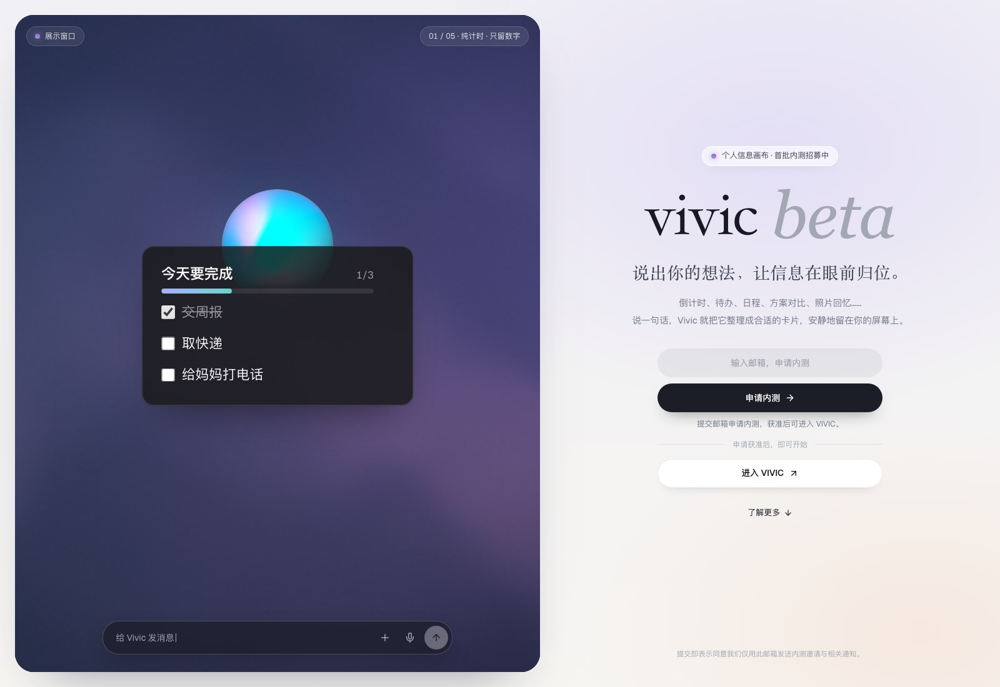
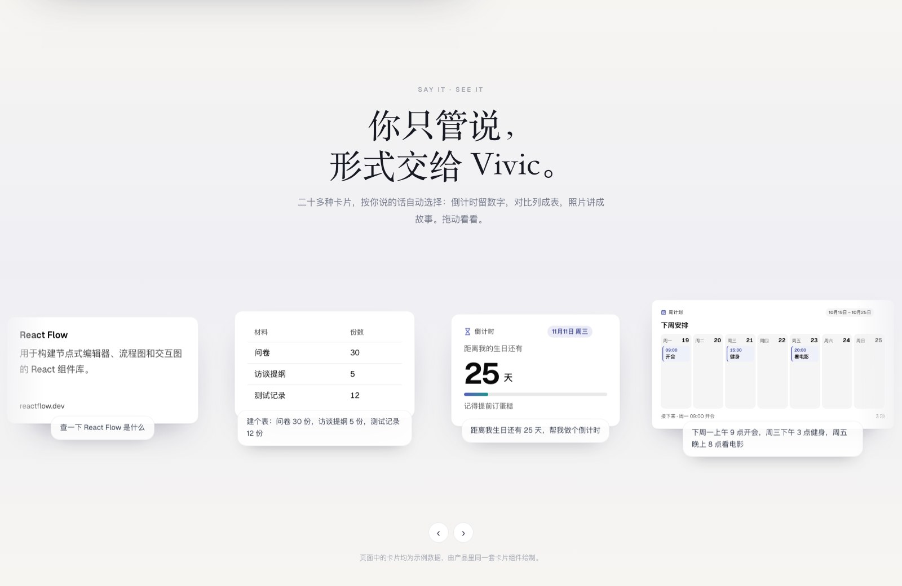
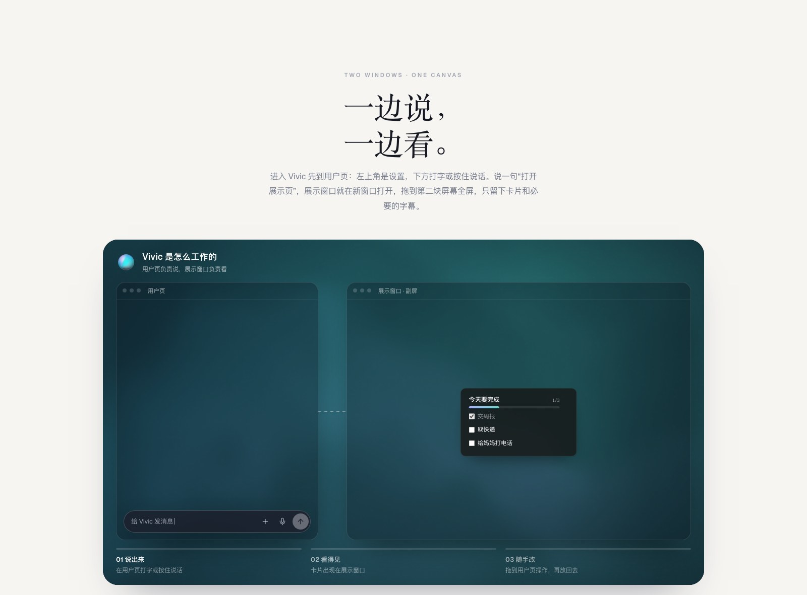
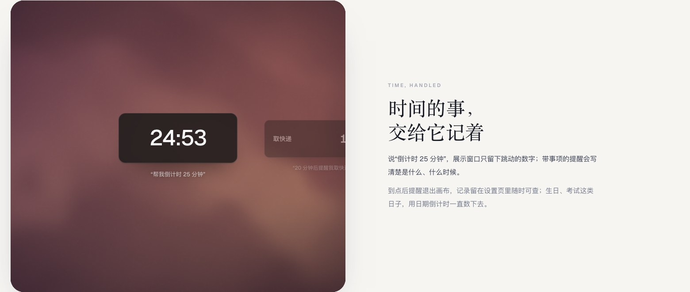
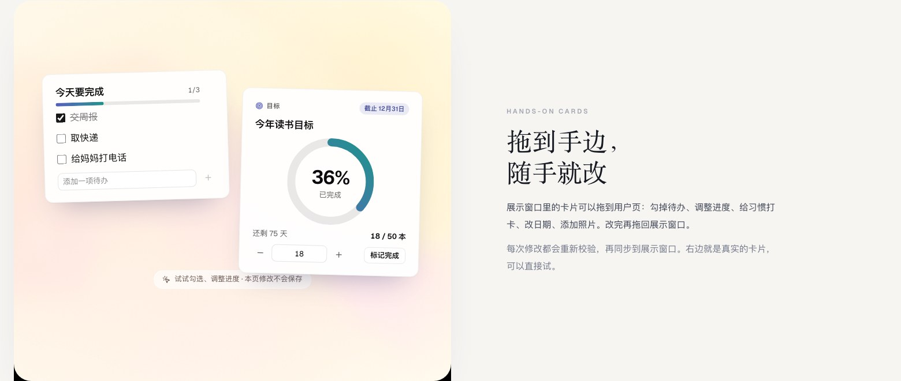
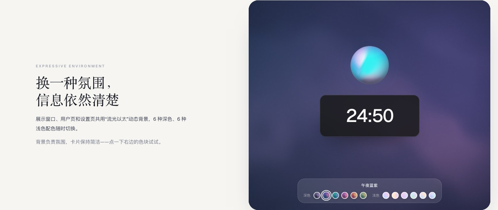
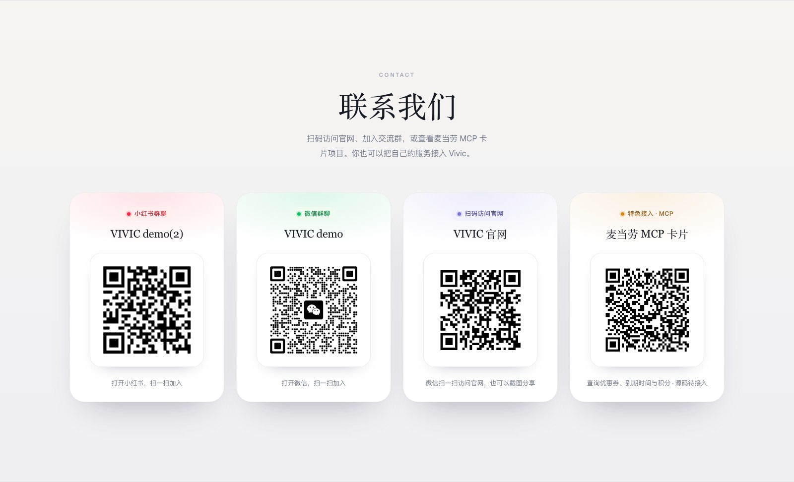

<div align="center">

# vivic

**说出你的想法，让信息在眼前归位。**

自然语言驱动的个人信息画布 · 用户页负责表达，展示窗口让信息安静呈现。

Voice & text → cards → your canvas.

[参与开发](CONTRIBUTING.md) · [本地功能路线](docs/LOCAL_ROADMAP.md)

[**访问官网**](https://edsionc.top/vivic/) · [界面预览](#界面预览) · [快速开始](#快速开始) · [加入交流](#加入交流)

</div>

[](https://edsionc.top/vivic/)

Vivic 把一句话整理成合适的卡片：今天的待办、下周的日程、生日倒计时、租房方案对比，或一组旅行照片。你可以在用户页打字、按住说话，把展示窗口放到另一块屏幕上，让需要的信息一直留在眼前。

**2026-10-24 开发更新**：Hark Web 极简界面、线上隔离会话、安卓扫码遥控、PDF / Markdown 文件卡与只读服务查询已经整合。最新文件阅读仅支持 PDF / MD，旧 Word 等原件保留下载。完整新增、更改和验收边界见 [本次同步说明](docs/updates/2026-10-24-github-sync.md)。本次同步源码，不代表官网已部署新版。

**官网：[edsionc.top/vivic](https://edsionc.top/vivic/)**，提供产品介绍、交互演示与内测入口。

<p align="center">
  <a href="https://edsionc.top/vivic/">
    
  </a>
  <br />
  <strong>微信扫一扫，访问官网</strong><br />
  可以保存二维码，或截图分享给朋友。
</p>

## 可以用它做什么

| 能力 | 使用方式 |
| --- | --- |
| 自然语言整理 | 直接描述要记录、比较或安排的事情，生成对应卡片；信息不明确时继续澄清。 |
| 多种场景卡片 | 支持倒计时、待办、周计划、月历、目标进度、习惯打卡、方案对比、图表、书籍、照片等场景，以及便笺、天气、搜索和表格等基础卡片。 |
| 旅游 DEMO | 无需连接模型即可生成旅游结果卡，支持选择、备注与刷新；明确标注虚构样例，不代表真实报价或可预订库存。 |
| 扩展卡片 | 导入 `.vivicard` 声明式包，在独立 Test Space 调参、预览、试跑后安装；支持禁用、卸载与重装恢复。 |
| 双窗口协作 | 用户页输入和编辑，Display 展示卡片；通过传送门点选或同页拖入，在两个标签页/窗口间双向传送，也可把展示窗口移到副屏。 |
| 时间与提醒 | 区分纯倒计时、带事项的提醒和日期倒计时，支持查看提醒记录。 |
| 可操作的画布 | 拖动、固定、找卡、聚焦、显示全部、恢复视图、查看详情、撤销，以及画布导入与导出。 |
| 模型与语音独立选择 | LLM 支持 StepFun Coding Plan、GPT / Pi OAuth；ASR、TTS 可独立配置或关闭。 |
| 有依据的信息 | 天气和联网搜索保留来源；模型返回经过契约校验的结构化数据。 |
| 统一背景 | 用户页、设置页与展示窗口共用 Hark 天空静帧，保留 6 种深色和 6 种浅色叠色；界面使用最新 Hark 组件。 |

例如，你可以说：

```text
今天要做：交周报、取快递、给妈妈打电话。
下周一上午 9 点开会，周三下午 3 点健身。
20 分钟后提醒我取快递。
今年读书目标 50 本，已经读了 18 本。
比较三套租房：A 月租 5200、通勤 15 分钟；B 4600、30 分钟；C 3800、50 分钟。
把这组数据画成折线图：周一 3，周二 5，周三 4。
下周去杭州住两晚，预算500。
```

## 界面预览

以下截图直接采集自 [VIVIC 官网](https://edsionc.top/vivic/)，拍摄于 **2026-10-17**。页面里的数字、日期、照片与卡片内容是演示数据，展示产品组件与交互方式。图片随仓库保存，点击可查看原图。

### 一句话，变成合适的卡片

倒计时留下数字，日程排成计划，对比列成表格，照片组成故事。



### 一边说，一边看

用户页 `/` 负责输入和操作，设置页 `/control` 管理模型与偏好，展示窗口 `/display` 呈现卡片。用户页与设置页属于同一个 Control owner，两窗口通过 BroadcastChannel 同步画布状态。



### 时间记得住，卡片也能改

| 时间与提醒 | 卡片交互 |
| :---: | :---: |
| [](docs/images/time-and-reminders.jpg) | [](docs/images/editable-cards.jpg) |
| 纯计时保持简洁，事项提醒写清楚要做什么。 | 勾选待办、调整进度，修改后校验并同步。 |

### 丰富的氛围，极简的信息

深浅配色随时切换，信息保持清楚。页面支持减少动态效果的系统偏好。



## 快速开始

需要 **Node.js >= 22.19.0** 和 **pnpm 12.11.2**（以根目录 `package.json` 的 `packageManager` 为准）。

```sh
git clone https://github.com/ECdison6227/vivic-canvas.git
cd vivic-canvas

# 已安装对应版本 pnpm 时可跳过
npm install --global pnpm@12.11.2

pnpm install --frozen-lockfile
pnpm dev
```

| 入口 | 地址 |
| --- | --- |
| 用户页：文字、图片与语音输入 | [http://localhost:5175/](http://localhost:5175/) |
| 设置页：模型、语音、画布与偏好 | [http://localhost:5175/control](http://localhost:5175/control) |
| 展示窗口 | [http://localhost:5175/display](http://localhost:5175/display) |
| 本地产品介绍与交互演示 | [http://localhost:5175/landing/](http://localhost:5175/landing/) |
| 本地 API | `http://127.0.0.1:8787` |

首次使用可直接输入“下周去杭州住两晚，预算500”体验旅游 DEMO，也可使用本地计时/提醒指令。复杂自然语言整理需在设置页连接 StepFun Coding Plan 或 GPT / Pi OAuth。语音可以单独配置，也可以保持关闭、直接使用文字。

日常开发端口固定为 `5175 / 8787`，自动化测试使用 `5174 / 8788`。`pnpm dev:web` 与 `pnpm dev:api` 可分别启动前后端。安装与协作见 [贡献指南](CONTRIBUTING.md)，当前优先完善本地版。

## 项目结构

```text
apps/
  web/                       React + Vite：用户页、设置页、Display 与官网落地页
  local-api/                 Hono：模型、语音、搜索、天气与动作校验
packages/
  contracts/                 共享的 Action / Card / State 契约
  card-runtime/              声明式卡片包解析、校验与打包工具
scripts/                     开发、校验与验证工具
docs/                        当前入口、功能说明、验收摘要
  archive/                   旧交接与旧阶段报告，不作为当前任务
  images/                    README 官网截图与二维码
Vivic_Kimi_Handoff_v0.6/      产品规格、架构与组件约定
CONTRIBUTING.md              安装、GitHub Desktop 与贡献流程
```

主要技术：**TypeScript、React、Vite、Hono、Zod、React Flow、Motion、Radix / shadcn、Assistant UI、Recharts**。画布使用 IndexedDB 保存，Control / Display 通过 BroadcastChannel 同步。模型与语音适配在本机后端处理。

## 开发与文档

```sh
pnpm typecheck         # 类型检查
pnpm test              # 前后端单元测试
pnpm contracts:check   # 共享契约一致性
pnpm build             # Web 构建
```

| 文档 | 内容 |
| --- | --- |
| [从这里继续](README_FIRST.md) | 当前版本入口与阅读顺序 |
| [贡献指南](CONTRIBUTING.md) | 安装、启动、分支和 PR |
| [团队任务](docs/TEAM_TASKS.md) | 按核心依赖分工，明确接口、代码范围与验收 |
| [文档目录](docs/README.md) | 按模块查阅与历史归档入口 |
| [Agent 交接](docs/AGENT_HANDOFF.md) | 最新进展、运行方式与后续约束 |
| [2026-10-22 更新说明](docs/updates/2026-10-22-card-platform.md) | 卡片平台、旅游 DEMO、传送门与底层更改 |
| [场景卡片](docs/scene-cards-20261017.md) | 20 种场景、结构化数据与卡片交互 |
| [用户页与统一背景](docs/user-page-20261017.md) | 用户页、设置页与配色 |
| [模型与语音架构](docs/provider-voice-architecture.md) | 模型、ASR 与 TTS 的职责 |
| [实施现状](docs/implementation-status.md) | 已完成、实验与待验收项目 |
| [组件与第三方许可](LICENSES.md) | 组件、包、模型与数据来源 |

## 加入交流

欢迎交流使用体验、反馈问题，或看看新卡片的进展。下面的交流群二维码直接取自官网；如果二维码更新，可以在 [官网「联系我们」](https://edsionc.top/vivic/#contact) 获取最新版本。

官网底部提供四个二维码：微信交流群、小红书交流群、Vivic 官网访问入口，以及 [麦当劳 MCP 卡片独立项目](https://github.com/ECdison6227/vivic-mcdonalds-mcp)。麦当劳项目计划支持优惠券、到期时间与积分查询，并提供 Vivic 卡片和独立 HTML 两种入口；目前已公开项目说明，源码待接入。

<table>
  <tr>
    <th align="center">微信 · VIVIC demo</th>
    <th align="center">小红书 · VIVIC demo(2)</th>
  </tr>
  <tr>
    <td align="center"></td>
    <td align="center"></td>
  </tr>
  <tr>
    <td align="center">打开微信，扫一扫加入</td>
    <td align="center">打开小红书，扫一扫加入</td>
  </tr>
</table>

<details>
<summary>查看官网「联系我们」原始截图</summary>



</details>

## 来源与素材

本仓库完整保留 [原账号仓库](https://github.com/franzkotkowski330-collab/vivic-canvas) 的代码与 Git 历史，在此基础上补充产品介绍、官网截图和访问二维码。原有开发文档与第三方归属记录一并保留。

截图来自 [edsionc.top/vivic](https://edsionc.top/vivic/)，演示卡片中的风景照片沿用项目内的 Unsplash 示例素材；采集说明见 [图片来源](docs/images/README.md)。组件、运行包、模型与数据的许可说明见 [LICENSES.md](LICENSES.md)。

<p align="center"><strong>丰富的氛围，极简的信息。</strong><br /><a href="https://edsionc.top/vivic/">edsionc.top/vivic</a></p>
