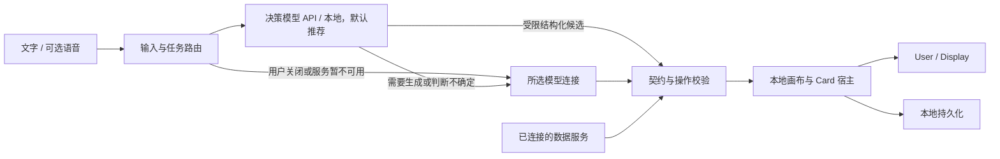

# 本地功能与协作路线

2026-10-19，依据用户最新要求：先把本地单人版功能跑通，再讨论服务器、多账号、免费/付费。当前三人协作：维护者重点优化核心流程，也可做新功能；两位伙伴可做 Landing、新卡片和新功能，按 [核心依赖与任务边界](TEAM_TASKS.md) 分工。下列项目尚未正式分配，也不表示已实现或已创建 GitHub Issue。

2026-10-20 已按会议确认 [人员与工单](team/README.md)：xlz 旅游/演示优先、UI 原型随后；马泽瑜决策优先、启动器随后；程佳锐核心/接入与 Test Space。这里的 Lxx 是产品路线，当前执行采用 PLAT/TRAVEL/DEC/RUN/UI/DEMO 工单；不把完整插件商店、收费或所有新手流程都设为旅游 PoC 的前置。

## 本地版本的完成目标

用户在本机打开 Vivic，选择自己的模型连接或预设服务连接，文字即可创建和操作卡片。决策模型作为正式接入能力，支持 API 或本地运行，默认优先引导配置并使用；用户明确关闭时允许直接走 LLM。语音仍独立配置。画布能够保存、恢复，外部 Card 有一条完整的开发、导入、使用路径。先交付一组有边界的功能，再逐步增加新场景。

决策服务未配置/不可用、超时或不确定时应明确提示并降级，不能阻断基础使用，也不能静默把用户的启用选择改为永久关闭。默认优先接入不表示未配置时擅自下载模型或使用未知凭据。用户补充的 JevHarness 先纳入 [适配评估](research/jev-harness-assessment.md)，当前协作准备流程继续。

“预设服务”本阶段指预先填好的服务商、端点、模型与能力配置，凭据由使用者连接。以后由 Vivic 运营的套餐可以接同一连接接口；平台付款、配额结算和公共服务凭据由后续阶段实现，不能把公共密钥嵌入前端或 Card 包。

## 当前依据

源码基线为 `d0f3cbf`。以下是源码检查结论；本机实际检查另记，历史测试数字不等于本轮通过。

| 能力 | 当前事实 | 本阶段动作 |
| --- | --- | --- |
| 用户页/设置/展示 | 已有三条路由，User 与 Control 共用 owner | 回归输入、切页、跨窗口及错误恢复 |
| 画布保存 | IndexedDB、JSON 导入导出、BroadcastChannel 已有 | 复用原链路；模板和快照在此基础上扩展 |
| 内置卡片 | `packages/contracts/src/scenes.ts` 有 20 个场景；另有基础卡片 | 保留已有 renderer，补场景验收与一致性 |
| 模型连接 | StepFun Plan、GPT/Pi 已实现 | 增加统一连接配置与一条明确的通用服务适配 |
| 语音/决策 | 已有独立语音选择，现有 Kev 仍是默认关闭的本地实验 | 改为正式 API/本地决策接入与默认推荐路径，保留用户关闭及故障降级 |
| Card 扩展 | 静态 Schema 和 renderer registry | 需要包协议、安装管理、隔离运行与恢复 |
| 外部服务 | 已有天气、搜索适配 | 通用 MCP 接入、持续刷新与卡片联动需开发 |
| 手机/其他设备 | 当前同步依赖同浏览器 BroadcastChannel | 不能直接称为已支持跨设备；留作后续独立任务 |

证据入口：`apps/web/src/cards/registry.tsx`、`apps/web/src/persistence/`、`apps/web/src/sync/`、`apps/local-api/src/app.ts`、`gpt/`、`preferences.ts`、`packages/contracts/src/`。

## 可分配的任务

每行是一项待建立/细分的任务，由维护者统筹分配。低依赖模块可交伙伴独立完成；中等依赖先固定接口/样例，再并行开发；核心流程改造由维护者牵头。大任务按契约、宿主、界面拆成相邻 PR，每个 PR 可验证，不把所有新功能都集中到维护者。

| 编号 | 交付 | 前置 | 验收条件 |
| --- | --- | --- | --- |
| L00 | 协作与本机环境基线 | 无 | 新 clone 按锁文件安装；类型/契约/单测/构建有实际记录；任务/PR 模板可用，失败形成明确问题 |
| L01 | 现有功能回归与阻断修复 | L00 | 隔离画布测试创建、编辑、删除/撤销、固定、切画布、刷新恢复；两种已有连接分别记真实结果；20 场景逐项记录，区分自动化与本人设备验证 |
| L02 | 统一模型连接协议 | L01 的阻断项关闭 | 定义连接 ID、适配器、模型、能力、凭据引用和状态；原两种 provider 可迁移，失败恢复明确；协议附测试，旧设置可读 |
| L03 | 自带服务与预设配置 | L02 | 先支持一种文档明确的 API 协议：填写地址/模型/Key→真实推理→选用→修改→断开；错误和取消可恢复，配置导出不含凭据；预设复用同一入口 |
| L04 | 决策模型正式接入与降级 | L02 | 统一 API/本地适配接口，至少一条真实路径通过后明确标记已支持范围；默认引导接入并在可用时参与决策，显式关闭才走用户选择的纯 LLM 模式；未配置、断连、超时和不确定可提示并临时降级；覆盖取消、恢复、中文场景与成本/延迟，STT/TTS 关闭不影响使用；先完成 JevHarness 适配评估，不照搬代码执行工具 |
| L05 | Card 扩展契约 | L01 | 定义 manifest、版本、查询/展示配置、只读结果、用户状态、编辑动作、主题与尺寸协议、宿主能力、迁移和缺失占位；一个实例能校验、序列化、恢复；非法数据不能派发到画布；设计参考 [扩展方案](CARD_EXTENSION_DESIGN.md) |
| L06 | 外部 Card 宿主与安装 | L05 | 在设置导入→解析校验→[Test Space 弹窗](CARD_TEST_SPACE.md) 预览/试跑→确认安装，再完成创建/编辑/保存/重启恢复/禁用/卸载；试跑与真实画布隔离，缺包保留数据；LLM 只可调用已安装且已启用的合法操作 |
| L07 | Card SDK、示例、开发文档与 Skill | L06 | 从独立目录按文档生成一个 Card，打包导入；宿主无需改源码/重新构建；另一人或干净环境可复现；Skill 随示例一起验证 |
| L08 | 空间模板 | L01 | 用现有卡片做学习/项目/专注三种组合；预览后创建新空间，卡片 ID 独立，不覆盖原空间；刷新恢复正常，日期按规则初始化，无伪造实时信息 |
| L09 | 一个 MCP 服务接入 | L02、L05 | 先选一种传输和一个实际服务；连接→列出允许的工具→调用→取消→断开，结果经 Schema 进入卡片；本地进程由本机后端管理，远程服务地址明确 |
| L10 | 一种持续更新的数据卡片 | L09 或现有数据适配 | 真实来源、更新时间、手动/定时刷新、离线和过期状态；相同卡片不重复刷新，失败有退避，网页关闭时的行为明确 |
| L11 | 一条确定的卡片联动 | L05、L08 | 例如待办完成后更新关联目标进度；重复事件不重复计数，取消完成可反向更新，解绑/删卡/刷新可恢复；首版只开放明确规则 |
| L12 | 空间快照与复制 | L01 | 命名保存布局和数据，预览并恢复为新空间，ID 重新映射；原空间保留，缺失 Card/媒体有可恢复提示；不重复开发已有 JSON 导出 |
| L13 | 本地版本交付 | 上述本期纳入项 | 干净安装、首次连接、核心使用、重启/断网、扩展安装与迁移均有记录；无阻断缺陷；列出真实声音/设备等未覆盖范围 |

建议执行顺序：**L00 → L01 → L02–L04 → L05–L07 → L08–L12 → L13**。希望尽早看到新体验时，可在 L01 后先完成 L08；它复用现有卡片，对后续连接与插件协议依赖少。L09–L12 分项交付，不把整组新功能塞进一个 PR。

## 平台与 Card 如何分工

平台提供连接、状态保存、布局、校验、操作执行和扩展宿主；Card 提供一种内容的展示、编辑以及受声明约束的操作。LLM 从已安装能力中选择并返回数据，宿主验证后执行；不执行模型现场生成的脚本。

伙伴可以开发新卡片、模板、Landing 和独立数据适配；每项先明确接口、代码范围和验收条件。`packages/contracts`、`app.ts`、`controlHost.ts` 等共享入口的变更由维护者协调并拆出集成点，避免多位 AI 同时改核心文件。主线不默认等待伙伴，可用固定样例支持双方独立开发。

Card 独立开发能力以 L07 验收为准。在那之前，新增内置卡片仍会改宿主源码，不能承诺用户已经能任意导入插件。MCP Apps 可作为 L06 的候选，但本轮不把某个未验证的运行方案定为既成实现。

## 本地阶段之后

完成 L13 后再安排部署、线上账号、跨设备同步、配额、免费/付费和运营套餐。手机控制可以先做设计；联网同步、设备配对和鉴权另设任务，不能通过直接开放当前 loopback API 代替。

远期候选保留：定时简报、共享空间、扩展目录、更多数据卡片。本地“完成”按本期勾选的任务定义，避免每出现一个想法就无限延长发布条件。

## 本轮准备的交付边界

已添加协作指南、任务/缺陷/PR 模板和 CI 配置，并纠正主仓库入口与旧云端优先计划。GitHub 上的看板、Issue、协作者权限和分支规则需要实际创建，本轮本地文件不代表这些远端设置已生效。新功能 L02–L12 仍是待开发任务。

L00 的本机自动化基线已验证：前端 520、API 1,070 项通过，另 3 项跳过；契约、类型、构建通过。Windows 契约换行问题已修复。详细范围与远端待验证项见 [本轮验证](verification/local-development-20261019.md)。下一项为 L01 的实际使用回归与阻断修复，再推进模型连接和 Card 扩展。
