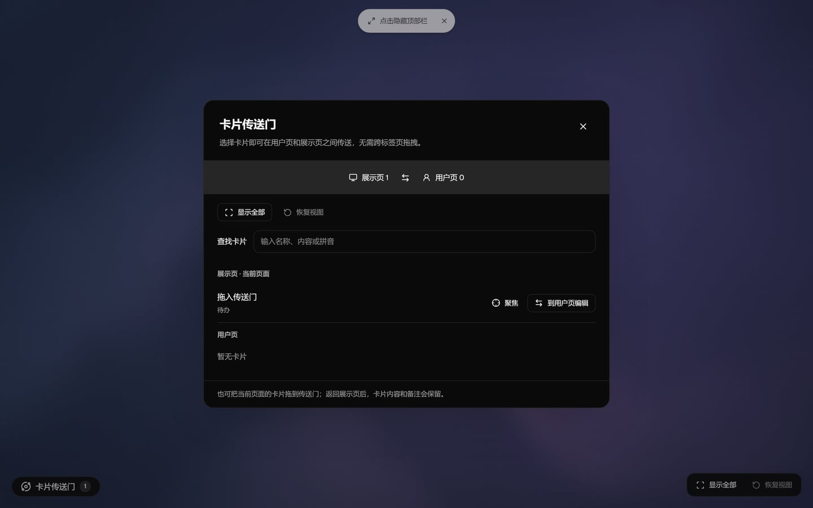

# 2026-10-22 更新：卡片平台、旅游 DEMO 与跨标签页操作

本轮交付 PLAT-01 卡片接入协议和参考实现、PLAT-02 声明式卡片包 v0.1，并补齐试用中反馈的卡片传送和画布操作入口。代码经任务分支提交 PR，具体合入状态和当前提交检查以 GitHub 为准。

关联任务：[PLAT-01 #9](https://github.com/ECdison6227/vivic-canvas/issues/9)、[PLAT-02 #10](https://github.com/ECdison6227/vivic-canvas/issues/10)。真实旅游适配和模型质量验收仍单独跟踪。

## 新增功能

### 两个标签页之间的卡片传送门

- 用户页顶部、展示页左下都有“卡片传送门”。点开选卡，或把当前页卡片拖进传送区，即可送到另一页，不再需要跨标签页拖拽。
- 用户页接收后可编辑卡片，点“传送到展示页”返回。传送移动同一张卡片，保留选择、备注与内容，不创建副本。
- 展示卡片悬停或键盘聚焦后提供“聚焦”“传送”；用户页和展示页均提供“显示全部”，聚焦后可以“恢复视图”。
- 传送门支持按名称、内容和拼音找卡；适配深浅色及窄屏。



### 无需模型的旅游 DEMO

- 输入“下周去杭州住两晚，预算500”，本地生成旅游结果卡，支持选择、个人备注和按原条件刷新。
- 卡片展示来源、查询条件、数据时间与 DEMO/过期标记。服务事实只读，模型和普通编辑不能改写结果、价格或来源；个人选择和备注可编辑。
- 通用 `ProviderResultSchema(itemSchema, querySchema)` 允许后续系列声明自己的查询参数与返回结果，真实服务通过受控适配器接入。
- 当前结果为虚构演示数据，不连接飞猪，不支持预订、下单或付款。

### 声明式扩展卡片包 v0.1

- 设置页导入 `.vivicard` / ZIP，静态校验后进入独立 **Vivic Test Space**；可以切换示例、User/Display、12 种背景配色并编辑参数。
- 当前样例试跑通过后才可安装；安装定义与创建画布卡片是两个明确操作。Test Space 不访问真实画布、模型或外部服务。
- 支持受限 JSON Schema、JSON Pointer 绑定和九类受控组件；校验 ZIP 路径、CRC、大小与包内容 SHA-256。
- 定义安装到本地，重启时重新校验；禁用/卸载保留实例数据，重新启用或导入精确原包可以恢复。
- 提供参考包源码 [`examples/card-packages/goal-progress`](../../examples/card-packages/goal-progress) 和检查/打包命令。

### 请求进度与评测工具

- 请求通过 SSE 显示当前处理阶段，带 requestId，最终通过校验的结果整体应用。
- 更新运行时提示词，明确受控动作、事实来源、澄清和能力边界。
- 新增 105 条中文离线 golden 回放及显式 live 模式。离线回放验证校验与构建链路，不代表真实模型准确率。

## 更改与修复

| 部分 | 本轮更改 |
| --- | --- |
| 保存与恢复 | IndexedDB v2、逐卡恢复/隔离、原始损坏数据备份与用户提示；支持超过 200 张卡片导入，导入前限制 UTF-8 文件大小。 |
| 模型上下文 | 最多 64 张，优先聚焦、固定和最近卡片；有界摘要明确标注截断，避免摘要覆盖完整原文或把局部列表当全画布操作。 |
| 页面性能 | 页面、图表和 Mermaid 懒加载；稳定卡片与节点引用，减少拖动时相邻重组件的重复渲染。 |
| 同步与视图 | Display 通过窄请求交给 owner 校验、持久化后确认；校验版本、画布、owner 会话、来源表面与布局基线，断开时禁用控件。固定卡片坐标保持不动，恢复使用展示窗口自己的原视口。 |
| 刷新与竞态 | 丢弃切换画布、删除重建、重复刷新后的旧响应；保留刷新期间最新备注。修复定义加载、安装、禁用、卸载及清理之间的竞态。 |
| 决策与语音 | 决策服务故障冷却 30 秒，手动启用可以立即重试；语音配置变化不再取消独立文字请求。 |
| 开发工具 | 改进 Windows 一键启动和所属进程树清理；加入 lint、浏览器 CI 冒烟，单元测试按项目使用 4 个 worker。 |

## 如何体验

```sh
pnpm install --frozen-lockfile
pnpm dev
```

1. 打开用户页 `http://localhost:5175/`，输入“下周去杭州住两晚，预算500”。
2. 点击顶部“展示窗口”。在展示页左下打开“卡片传送门”，把旅游卡送到用户页编辑，修改备注、选择或刷新后传回。
3. 悬停展示卡片点击“聚焦”，再用右下“恢复视图”或“显示全部”。
4. 制作参考卡片包：

   ```sh
   pnpm card:pack examples/card-packages/goal-progress goal-progress.vivicard
   pnpm card:check goal-progress.vivicard
   ```

5. 设置页 `/control` → “扩展卡片管理”导入该包 → 试跑 DEMO → 安装卡片 → 从 DEMO 创建卡片。

打包器拒绝覆盖已有输出；再次打包时换一个输出文件名。首次使用上述流程不需要模型；复杂自然语言整理和按扩展卡名让模型创建实例需要有效模型连接。用户页需保持打开，负责同步和保存。

## 验证与兼容性

- 本地记录：Web **595** 项、API **1167** 项单元测试通过，另 3 项既有真实服务测试跳过；两套完整检查分阶段执行。提交 GitHub 时的干净 PR 工作区复验结果和当前 head 检查写在 PR 正文与 CI 中。
- 105/105 离线 golden 回放通过；类型、生成契约、lint、构建和卡片包检查通过。保留既有 lint 与构建警告。
- 平台阶段 56 项关键浏览器场景分批通过；随后新增 3 项传送门流程并复验 2 项既有画布交互。没有宣称整套浏览器测试在同一轮全部通过。
- 生成契约新增旅游/扩展卡片及服务来源；旧内置卡片与画布保留兼容恢复。仅安装包不会自动迁移或创建现有卡片。
- v0.1 不支持任意代码/React 插件、包内网络调用或包内真实服务试跑。真实飞猪适配仍待接入；已有真实模型抽样曾被本地认证 401 拒绝，尚无模型准确率结论。

完整记录：[平台验收](../verification/platform-20261021.md)、[传送门验收](../verification/card-portal-20261022.md)、[当前能力边界](../CAPABILITIES.md)、[卡片包与 Test Space](../CARD_TEST_SPACE.md)。本轮不发布网站、不合并 #13/#14 的待修改内容，也不改变已通过 #15/#16 合入主线的记录。
