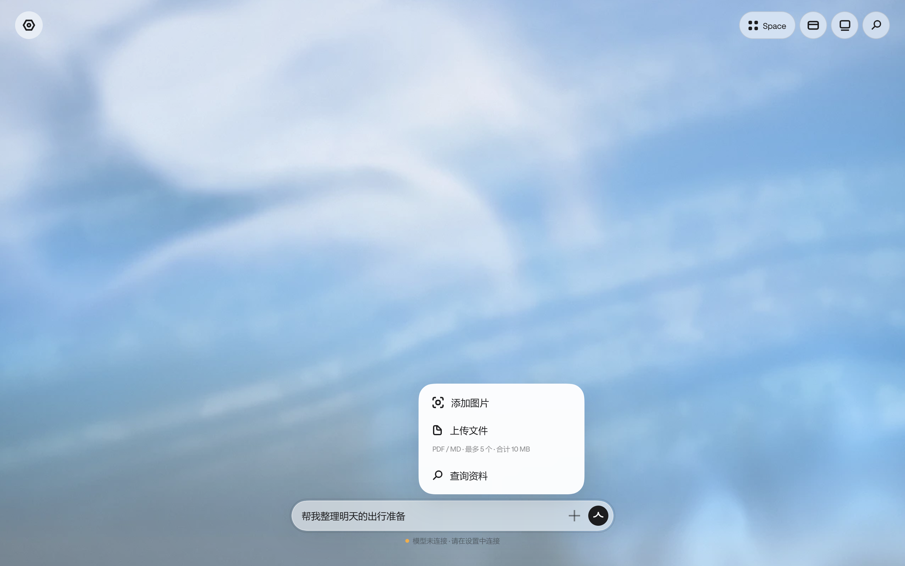
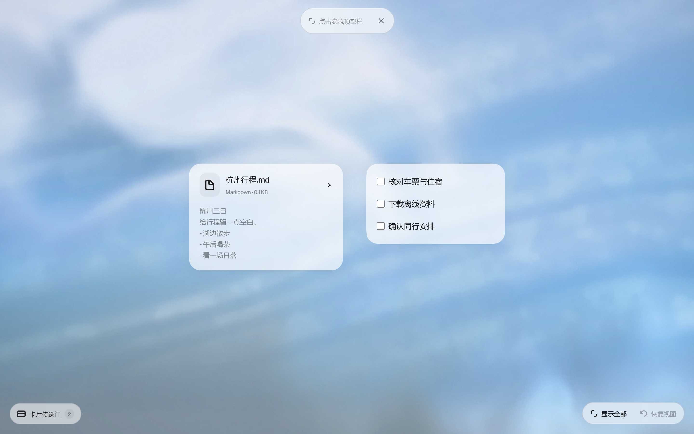

# 2026-10-24 GitHub 同步说明

本次将此前保留在本地的可运行集成版本提交到独立分支。远端 main 尚未包含卡片平台、手机和启动器分支，因此本次也带入这些必需基础；不会自动合并 PR、关闭伙伴 PR 或公开部署服务。

## 最新体验

- 明确采用 [REA UI Library 的 Hark Web](https://github.com/ECdison6227/rea-ui-library/tree/26ac2724f29b4ee46962146fed2b6d545bf62180/platforms/web/hark)，复用原字体、glyph、材质和连续圆角，保留来源说明；交互与业务适配单独记录。
- 聊天中合并图片、上传和查询入口至“＋”，精简顶部工具；设置采用连接/偏好/数据的小面板。详细参数按需展开，不继续增加主页面常驻功能。
- 文件卡点击即读，只支持 PDF 和 Markdown 新上传及内置阅读。PDF 原页翻页、MD 排版、长文分段，下载保留原件；问 Vivic 为可选侧栏。Word/TXT/CSV/JSON 历史数据可加载与下载，但不再预览或交给模型。
- 上传最多 5 个文件，单次合计 10 MB，空间容量 100 MB。删除卡片后原件暂留以支持撤销；文件原件当前保存在电脑浏览器 IndexedDB。
- 手机扫码后只有聊天 / 纵向 Space；卡片传送是实际移动，聊天与 Space 不重复显示，且同步电脑。手机只读阅读和原件下载，初始配置仍在电脑完成。

具体映射和本轮细节见 [Hark 精简](2026-10-24-hark-minimal.md)、[阅读层](2026-10-24-reader-polish.md)、[Connected Space](2026-10-24-connected-space.md)。旧文档当时开放的 DOCX 等格式，以本次 PDF / MD 白名单为准。

下面是本轮实际页面截图，内容为独立演示资料：

## 一同同步的运行基础

- 三步线上引导、优先 API Key、隔离会话后端、线上手机配对，以及 Docker / Linux / HTTPS 反代验收入口。
- 飞书 MCP / Lark CLI、麦当劳 MCP、企微 CLI、钉钉只读查询适配；自然语言选择受控查询、结果保存为有来源的卡片、每会话独立授权。
- 27 种卡片 renderer、Office / Planner 包、排序与分区预览、固定卡片避让、空间撤销重做、子卡片和可控动态光效。
- Windows / macOS 本地启动与安装脚本、按硬件选择 StartLux 档位、Sherpa/Kokoro 本地语音入口、Android 原生扫码安装包构建。Android 当前 0.1.9 / code 10。
- Jev 原生决策任务、保存回执、取消/超时/晚到结果防护，以及开发用的自造小样训练和独立评测入口。正式原生决策质量门控仍关闭，不把流程测试当作模型效果达标。

## 验证与真实边界

提交前的可运行交付已通过本轮 43 个 Web 定向单测、5 个文件 API 测试、20 个浏览器场景，以及类型、构建和相关 lint。Windows 隔离安装 12 项通过；安装后的 Markdown 阅读和打包 Worker 实测通过，普通阅读 0 次模型请求。Android 生产包 v2/v3 验签通过。此次 GitHub 提交的额外检查以 PR 内结果为准。

GitHub 同步前额外检查：全量 Web 784、API 1364、手机协议 119，共 2267 项通过，3 项外网诊断按既有配置跳过；契约生成检查、全仓类型与 lint 通过（建议级警告保留）。仅由暂存文件导出的干净副本完成 `--frozen-lockfile --offline` 安装、契约检查和 Web/手机生产构建，确认不依赖本地未提交缓存。暂存内容不含密钥、模型权重、运行日志和安装包。

前一阶段的全量 Web / API、真实 StepFun、Mac mini 和安卓扫码验收见 [完整验收](2026-10-24-full-acceptance.md)。这些历史结果的范围与本次定向检查分开，不声称每轮都重跑全部模型/设备。

- 真实外部服务仍需用户自己的授权；连接器 fixture 数据不是个人账号的真实查询结果。
- APK 正式公网 HTTPS 链、物理语音以及 Mac 签名公证仍有待发布阶段验收；本轮不发布服务。
- 原文件不在云端自动同步，画布 JSON 备份不包含文件原件；手机没有独立上传和文件数据库。
- 4B Jev v2 的完整任务质量门控尚未达标；不能称特调模型已正式可用。
- 原 Hark 资产保留原权利与归属，不以本项目许可覆盖其权利条件；来源包 partial 不代表所有原版业务和状态都已复现。

## 开发与安装

`pnpm install --frozen-lockfile` 后可运行 `pnpm dev`。类型、契约、测试、构建分别为 `pnpm typecheck`、`pnpm contracts:check`、`pnpm test`、`pnpm build`。线上部署见 [online-deployment](../online-deployment.md)，Android 源码构建见 [apps/android/README](../../apps/android/README.md)。本机生成的安装包、模型权重、密钥、日志、截图和缓存不提交到源码仓库。
